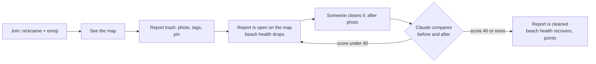
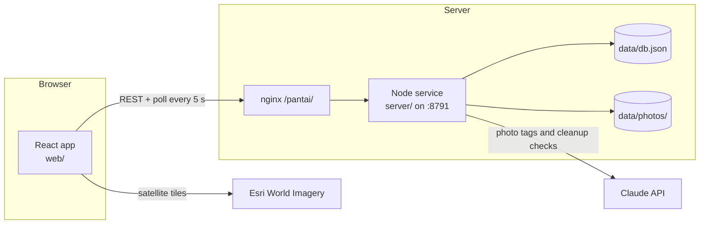

# How Hai Pantai works

Hai Pantai turns beach cleanup on Bali into a game. People photograph trash on the coast and drop a pin. Anyone can then clean that spot and prove it with an "after" photo. Every coastal village is a beach team, and beaches compete in a weekly league: the cleaner the beach, the higher it ranks. Players collect points and badges along the way.

This page explains the app from the player's side first, then follows a report through the code.

## 1. What a player does

1. **Join.** A player picks a nickname and an emoji avatar. There is no login: the server returns a secret token, and the browser keeps it in `localStorage` (`web/src/lib/api.ts`). Every later request sends it in the `x-player-token` header.
2. **Browse the map.** Each beach's coastline is coloured by its health (green, amber, red, or grey when it has no recent reports). Open reports are red dots, hotspots glow, cleaned reports are green. The map has a Map mode (drawn shapes, no tiles) and a Satellite mode (Esri imagery).
3. **Report trash.** The big **Report trash** button opens a sheet with three steps:
   - **Photo.** The phone camera or gallery. The photo is shrunk in the browser to a JPEG of at most 1280 px (`web/src/lib/photo.ts`) before upload.
   - **Tags.** Claude looks at the photo and suggests a trash type (plastic, bottles, nets, organic, mixed, other) and a size (S = a handful, M = a bag, L = more than a bag). The player can change both.
   - **Pin.** The pin starts at the player's GPS position (only on HTTPS or localhost) or the map centre, and the player can move it. The pin always snaps to the nearest point on the coast, which decides which beach the report belongs to.
4. **Clean a spot.** Tapping a report opens its detail. **I cleaned this** asks for an after photo. Claude compares it with the original photo and returns a clean score from 0 to 100 and a short reason.
5. **Compete.** The **League** tab ranks the beaches and lists the top 20 players. The **Me** tab shows the player's points, badges and reports, plus language and theme settings.

## 2. The game rules

All rules live in one file, `shared/game.ts`. The server and the app both import it, so they always agree on the numbers.

| Rule | How it is calculated |
|---|---|
| Size multiplier | S = 1, M = 2, L = 4 |
| Points for a report | `10 × multiplier` (10, 20 or 40) |
| Hotspot | An open report that is size L, or older than 48 hours |
| Points for a cleanup | `round(30 × multiplier × score / 100)`, doubled for a hotspot. A score below 40 earns nothing and the report stays open |
| Beach health | `100 − weight of its open reports`, where S = 5, M = 10, L = 20, never below 0 |
| League | Only beaches with a report in the last 7 days are ranked, so a beach cannot win by never reporting. Order: health, then cleanups this week, then name |
| Weekly challenge | All players together: clean 50 spots since Monday 00:00 Bali time (WITA, UTC+8) |
| Badges | First report, first clean, ten cleans, hotspot hunter, big haul (cleaned an L), three beaches (reported on 3 beaches) |

Points and badges are never stored. The server works them out from the list of reports each time it builds the game state, so they can never drift out of step with the data.

## 3. The parts

| Part | Where | What it does |
|---|---|---|
| Shared rules and types | `shared/` | `types.ts` (reports, players, beaches), `game.ts` (rules above), `coast.ts` + `coast.json` (beaches and coast snapping) |
| Server | `server/src/` | A plain Node HTTP server with no runtime libraries. It serves the API, the photos and the built web app |
| Web app | `web/src/` | React, Tailwind, shadcn components and MapLibre for the map |
| Deploy | `deploy/`, `scripts/release.sh` | A systemd service and an nginx snippet that publish the app at `/pantai/` |

### The beaches and the coast

A "beach" is one coastal village (desa). `scripts/build-coast.mjs` took Bali's 716 village outlines, kept the villages that touch the sea, and saved each one's coastline as lines in `shared/coast.json`.

`snapToCoast(lng, lat)` in `shared/coast.ts` finds the nearest point on any of those coastlines. It first sorts beaches by the distance to their bounding box, so it can stop early instead of checking every line. The app calls it while the player moves the pin (to show the beach name), and the server calls it again when the report arrives, so the stored location is always on the coast.

### The server

`server/src/index.ts` starts an HTTP server; `server/src/app.ts` handles every request. Any path containing `/api/` goes to the API; everything else is a file from the built web app (or `index.html`, so the app loads on any path).

| Endpoint | What it does |
|---|---|
| `GET api/state` | The whole game in one reply: all reports, the league, the top 20 players, the weekly challenge and, when a token is sent, the player's own points and badges |
| `POST api/players` | Join. Checks the nickname (2 to 20 characters) and returns a player and a token |
| `POST api/ai/tag` | Sends a photo to Claude and returns the suggested type, size and a short summary |
| `POST api/reports` | Saves a report: checks the fields and that the photo is a real JPEG, snaps the pin to the coast, saves the photo, and returns the points and any new badges |
| `POST api/reports/:id/clean` | Saves a cleanup: asks Claude to compare the before and after photos, and if the score passes, marks the report cleaned and awards points |
| `GET api/photos/:file` | Serves a stored photo |

**Storage** (`server/src/store.ts`) is a single JSON file, `data/db.json`, with two lists: players and reports. It lives in memory; after a change, it is written to disk at most every 300 ms, through a temporary file and a rename so a crash cannot leave half a file. Photos are separate JPEG files in `data/photos/`.

**Protection.** Requests over 3 MB are refused. There are per-address limits per hour (joins, reports, AI calls) and a limit of 30 Claude calls per player per hour, because the demo is shared. A report that is being cleaned is locked, so two people cannot clean it at once and both get points.

### Claude

`server/src/claude.ts` calls the Anthropic Messages API directly with `fetch`. There are two jobs:

- **Tagging** a new photo: "is this trash, what type, what size, a summary in under 12 words".
- **Checking a cleanup**: given the before and after photos, "score 0 to 100 how clean the spot is now, and why". It must score 0 if the after photo is a different place or still shows the trash. If the before photo is an illustrated demo placeholder, Claude only sees the after photo and judges whether it shows a clean spot.

Claude replies with JSON. The server checks every field and falls back to safe values when one is missing. Claude writes its summary or reason in the player's language (English, Chinese or Indonesian).

The app keeps working without Claude. With no `ANTHROPIC_API_KEY`, or when the call fails or times out (20 s), the player picks the tags by hand, and a cleanup gets a score of 70 marked "unverified". One exception: if Claude says it cannot read the image, that is the photo's fault, so the cleanup scores 0 instead of passing as unverified.

### The web app

- `web/src/App.tsx` shows the welcome screen until the player has joined, then three tabs: Map, League and Me. The map stays mounted while other tabs are open, so it does not reload.
- `web/src/lib/useGame.ts` fetches `api/state` every 5 seconds. That poll is how players see each other's reports and cleanups: there are no websockets. If the server no longer knows the token (for example, after a data reset), the player goes back to the welcome screen.
- `web/src/components/GameMap.tsx` draws the map with MapLibre: land from `web/public/land.json`, coastlines coloured by health, and report dots, all as GeoJSON layers that update when new state arrives.
- `ReportSheet.tsx` is the three-step report flow; `ReportDetail.tsx` shows a report and runs the cleanup; `PointsToast.tsx` celebrates points and new badges.
- `web/src/lib/i18n.ts` holds all interface text in English, 简体中文 and Bahasa Indonesia. `web/src/lib/theme.ts` switches light and dark. Both start from the browser's settings and remember the player's choice.

## 4. One report, end to end

1. The player picks a photo. The browser resizes it and sends it as base64 to `POST api/ai/tag`.
2. The server checks the token and the limits, asks Claude, and returns `{ type, size, summary }`. The sheet pre-selects those tags.
3. The player places the pin and submits. `POST api/reports` receives the location, tags and photo.
4. The server snaps the location to the coast to find the beach, stores the photo as `<id>.jpg`, adds the report with status `open` and `10 × multiplier` points, and saves.
5. The reply carries the points and any badges just earned; the app shows a toast and flies the map to the new pin.
6. Within 5 seconds every other player's poll returns the new report. The beach's health has dropped by the report's weight, which can change its league position and its colour.
7. Later, someone taps the pin and sends an after photo to `POST api/reports/:id/clean`. The server loads the before photo, asks Claude to compare, and on a score of 40 or more saves the after photo, marks the report `cleaned` and records the score, reason and points. The beach's health goes back up.

## 5. Demo data and deployment

- `npm run seed -w server -- --reset` (`server/src/seed.ts`) creates 10 demo players and about 60 reports on well-known beaches over the last 6 days, a third of them cleaned. They are marked `seeded` and the app labels them "demo". Their photos are illustrated SVG placeholders, not real photos.
- `scripts/release.sh` builds the web app and bundles the server into `release/pantai.tgz`. On the VPS, `deploy/setup.sh` installs Node if needed, sets up the `pantai` systemd service on port 8791, and writes the nginx snippet that forwards `/pantai/` to it. Running it again updates the app and keeps the data.

## 6. Known limits

- The VPS runs plain HTTP, so browsers block GPS there; players place the pin by hand.
- No accounts, moderation or duplicate detection. Losing the browser's storage means losing the player.
- One JSON file and a 5-second poll are fine for a demo, not for many thousands of players.
