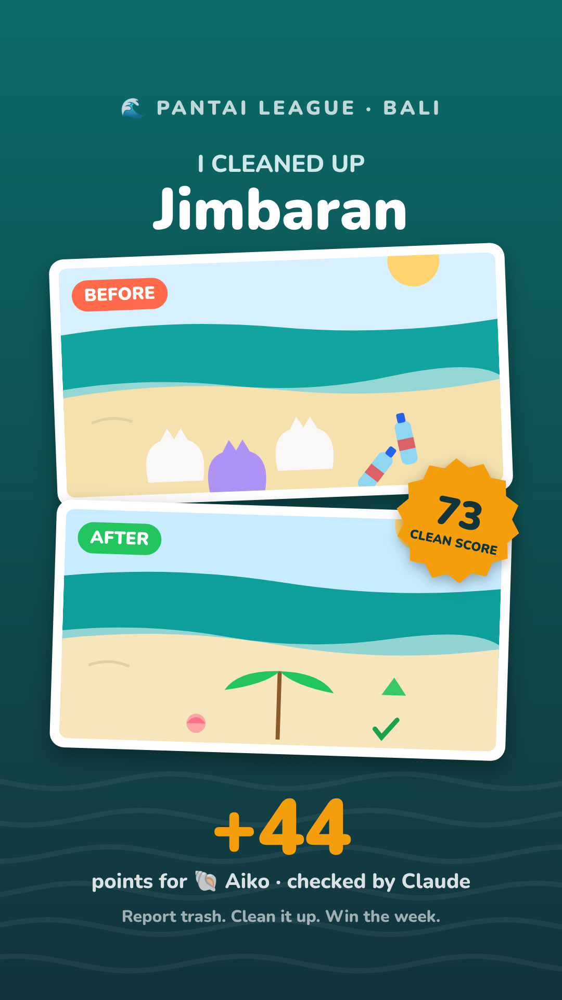
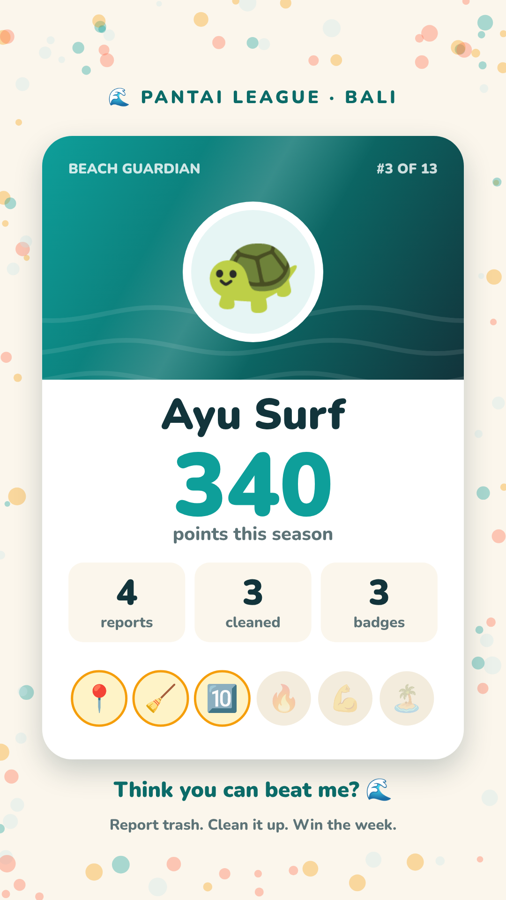
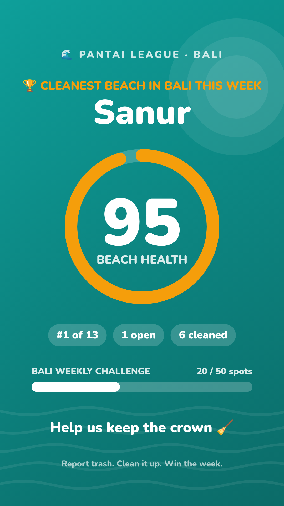
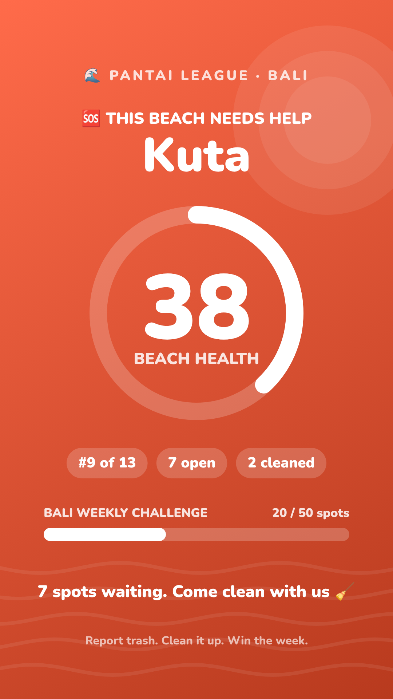
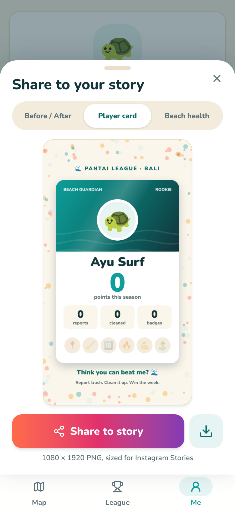

# Instagram story cards

Players can share a 1080 × 1920 PNG to their Instagram story. The app draws it on a canvas in the browser (`web/src/lib/shareCard.ts`), then opens the phone's share sheet. Instagram is one of the targets there. Where the browser can't share files, the app downloads the PNG instead.

Instagram covers about 250 px at the top and bottom of a story, so the key content sits between y 220 and y 1700.

| Concept | Where to share it | What it shows |
|---|---|---|
| **1. Before / After** | A cleaned report, or the player's latest cleanup | Beach name, before and after photos as tilted polaroids, a clean score stamp, points earned and who cleaned it |
| **2. Player card** | Me tab, "Share my card" | A trading card with the avatar, nickname, points, rank, stats and all six badges (the ones not yet earned are faded). Call to action: "Think you can beat me?" |
| **3. Beach health** | League winner, or from the share sheet (the player's home beach) | A health ring, rank, open and cleaned counts, and the Bali weekly challenge. The colour and headline change with the standing: teal and gold for #1, teal for "climbing", coral "needs help" when health is under 50 |

| Before / After | Player card | Beach (winner) | Beach (needs help) |
|---|---|---|---|
|  |  |  |  |

The share sheet lets the player switch between the three concepts:

The sample cards use the seeded demo data. The demo photos are illustrated placeholders.
